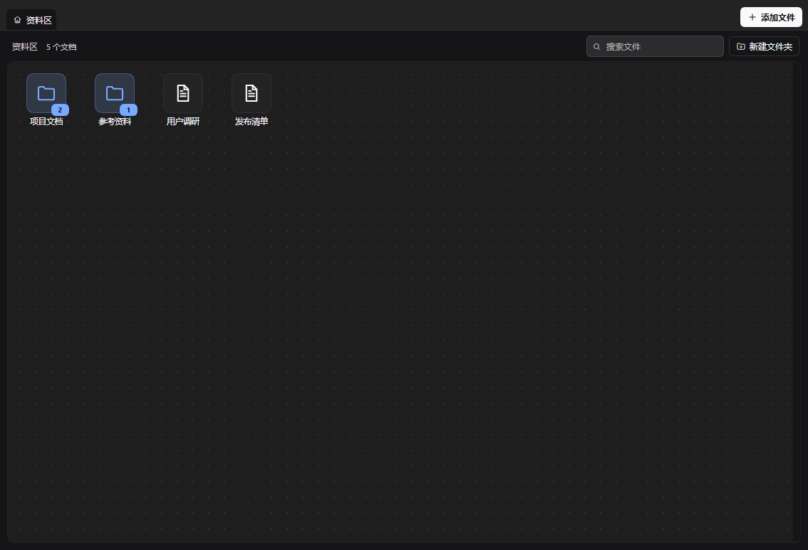
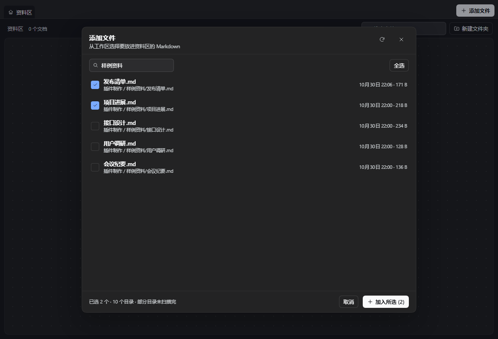
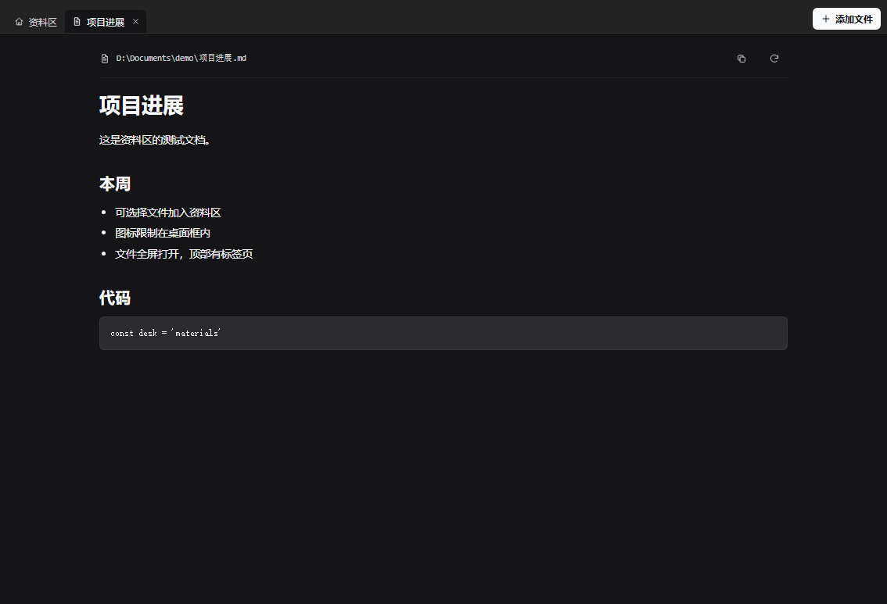
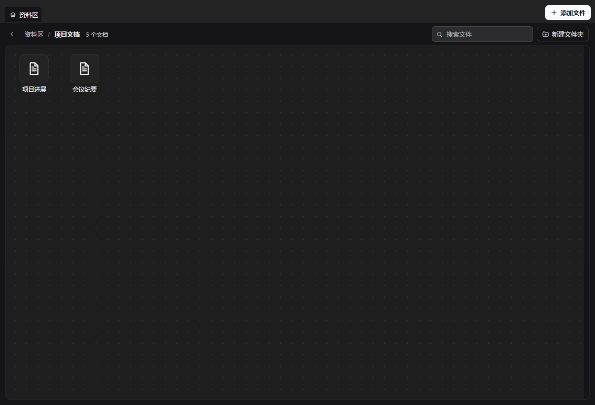
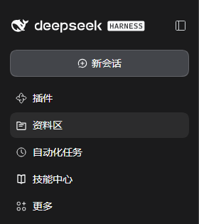

# dsh-docdesk · 资料区

An **add-only** Markdown library for DeepSeek Harness. The library starts empty: you pick the documents that matter from your workspaces, place their icons on a fixed non-overlapping desktop grid, and read them full-screen with browser-style tabs.



## Why

DSH agents write notes, plans, research and reports as `.md` files. The files stay in the workspace, but the conversation that produced them scrolls away. 资料区 keeps the documents you choose in one place without turning your whole workspace into a list:

- Nothing is imported automatically. You decide what enters the library.
- Icons sit on a fixed desktop grid. Two icons never share a slot; the desktop scrolls when there are more icons than fit.
- A document opens as a full-screen reader with tabs, not a cramped side drawer.

The plugin never moves, renames or deletes anything on disk.

## Features

- **Add files explicitly.** The **Add files** button opens a workspace picker with search and multi-select. Documents already in the library are marked and cannot be added twice.
- **Add from a file card.** A delivered Markdown file card gains an **Add to library** action; right-clicking the card opens a small menu with the same action. If your host does not render deliverable file cards, the picker is always available.
- **A fixed, non-overlapping desktop grid.** Icons snap to slot positions inside the desktop frame. Dropping one onto an occupied slot swaps the two icons, and new icons fill the first free slot. When there are more icons than fit, the desktop scrolls instead of stacking icons on top of each other.
- **Virtual folders.** Create folders and drag documents onto a folder icon. Folder badges show how many items are inside. Folders can be nested.
- **Rename anything.** Use the context menu or <kbd>F2</kbd>. The label in the library changes; the file on disk does not.
- **Full-screen reading with tabs.** Double-click a document to open it full-screen. The top row is a browser-style tab strip with a Home tab and one tab per open document; tabs can be switched and closed.
- **Sidebar handle.** A slim handle at the middle of the left edge collapses the sidebar and stays available to bring it back. It uses the host's own sidebar toggle, so it collapses to the host's icon rail.
- **Search and remove.** Filter the current page by label or path; remove an entry from the library without touching the file.
- **Bilingual UI and theme-aware styling.** Chinese and English follow the Harness locale; colors come from the host theme tokens.



## Install

### From the plugin market

Once the entry is merged into [awesome-dsh-plugin](https://github.com/awesome-dsh-plugin/awesome-dsh-plugin), open **Plugins → Discover**, search for **资料区** or **Materials**, and install it. The market installs from this repository; npm publication is optional.

### From GitHub

```sh
dsh plugin --profile <your-profile> add https://github.com/wei238982377/dsh-docdesk
```

In DSH Desktop you can also open **Plugins → Add** and paste the repository URL. The bundle is a source package: the root `package.json` declares `dsh.bundle` and `cordis.patch.yml`.

After installation, refresh the browser tab once so the client plugin loads.

## Use

- Open **资料区** in the left sidebar.
- Click **Add files** (top-right). Search if needed, tick one or more documents, then click **Add selected**.
- Drag an icon to move it; it snaps to a fixed slot. Dropping it onto an occupied slot swaps the two icons. New icons fill the first free slot. If the desktop has more icons than fit, scroll vertically.
- **New folder** creates a folder in the current page. Drag a document onto a folder icon to file it; double-click the folder to open it.
- Right-click an icon for **Open, Rename, Copy path, Move to folder** and **Remove from library**. Folders also offer **Delete folder**, which moves their documents back to the parent instead of deleting files.
- Double-click a document to open it full-screen. Use the **资料区** tab to return to the desktop, click another tab to switch documents, and use the × on a tab to close it.
- The middle-left handle toggles the sidebar. The host collapses it to its icon rail; click the handle again to restore it.



## How it works

The bundle has two halves:

- **Host half** (`index.js`) scans registered workspaces, the profile's default working directory and live agent working directories for `.md`, `.markdown` and `.mdx` files. It exposes three read-only JSON endpoints:
  - `GET /api/dsh-docdesk/list` — candidate files for the picker
  - `GET /api/dsh-docdesk/read?path=<absolute path>` — one document's content
  - `GET /api/dsh-docdesk/resolve?sessionId=…&seq=…&index=…` — resolve a delivered file card's durable coordinates to a path
- **Client half** (`client.js`) registers the **资料区** sidebar entry, the panel, the middle-edge sidebar handle and the delivered-file action. It renders the desktop, the picker, folders and the tabbed reader.

Data and limits:

- The library (documents, display names, folders, positions, open tabs) is stored in the browser under `dsh-docdesk.library.v2`; it is per browser profile and is not synced between devices.
- The Markdown files remain the source of truth. If a file is moved or deleted outside the plugin, opening it reports the error and lets you remove the entry.
- Both the list and read endpoints sit behind the same loopback / paired-device fence used by the bundled management pages and reject forwarding headers. Reads are confined to scanned roots and Markdown extensions; a preview is capped at 2 MB.
- The scan skips `node_modules`, `.git`, build output and virtual environments. Current caps are 3,000 documents, 4,000 directories per workspace, 16,000 directories in total and 6 levels of depth.
- The sidebar handle calls the host's `layout.toggleSidebar()`. The collapsed state is the host's rail, not a custom zero-width column.

## Screenshots

| Panel | Add files | Full-screen document |
| --- | --- | --- |
|  |  |  |

| Folder | Sidebar entry |
| --- | --- |
|  |  |

## Project layout

```text
dsh-docdesk/
├── index.js              # Host half: scan, read, resolve delivered-file coordinates
├── client.js             # Browser module: sidebar entry, panel, tabs, picker, file action
├── cordis.patch.yml      # Bundle patch that mounts the plugin row
├── package.json          # Manifest: dsh.bundle, dsh.client, exports, files
├── locale/
│   ├── en.json           # Plugin manager metadata (English)
│   └── zh.json           # Plugin manager metadata (Chinese)
├── icon.svg              # Bundle icon (used by the plugin manager)
├── screenshots.json      # Market screenshot list
├── docs/
│   ├── icon.png          # Raster icon used by the market listing
│   ├── market-entry.yml  # Registry entry submitted to awesome-dsh-plugin
│   └── screenshots/      # README and market screenshots
├── CHANGELOG.md
├── LICENSE
├── README.md
└── README.zh.md
```

## Development

There is no build step. `index.js` is a plain ESM Cordis plugin; `client.js` is a browser module registered through `window.__ModuleLoader__.load` with the package name as its id. Edit either file, then refresh the browser tab. For a host-half change, reinstall the bundle (or restart the host) so the new module generation is loaded.

```sh
dsh plugin --profile <your-profile> add /absolute/path/to/dsh-docdesk
```

The only runtime imports are Node built-ins (`node:fs`, `node:path`) on the host and `react` from the host module table on the client. There are no npm dependencies to install.

## License

MIT. See [LICENSE](LICENSE).

---

[中文说明](README.zh.md)
