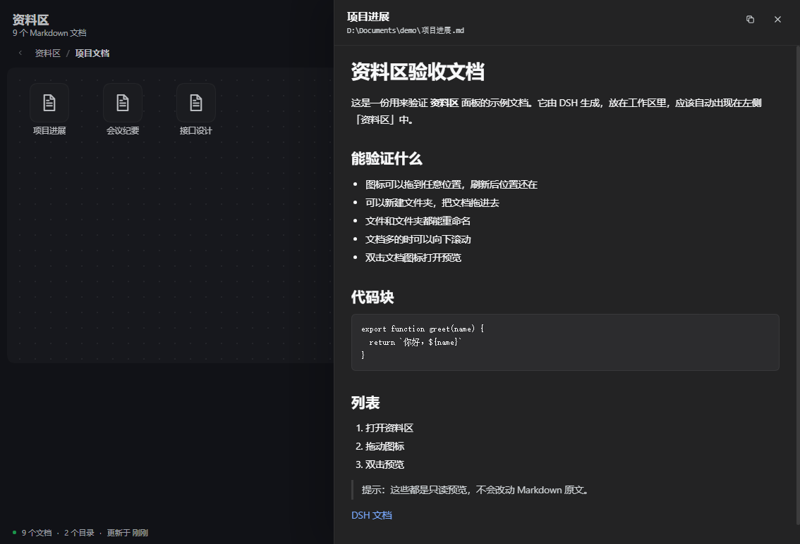

# dsh-docdesk · 资料区

把 DeepSeek Harness 生成的 Markdown 文档收进一个桌面式资料区。不用再翻历史会话找刚才那份报告——点开左侧的 **资料区**，各个工作区里的 `.md` 文件已经摆在那里，像电脑桌面一样。


## 为什么做这个

DSH 的智能体会把笔记、方案、调研和报告写成 `.md` 文件。文件留在工作区里，但生成它的那段对话会越滚越远。资料区把这些文档集中到一个地方，并且按你的习惯来摆放：图标随便拖、相关内容收进文件夹、随手改名、不离开当前会话就能读。

插件刻意做成只读：不会移动、重命名或删除磁盘上的任何文件。

## 功能

- **图标自由摆放。** 把图标拖到画布任意位置；刷新页面、重启浏览器后位置还在。
- **虚拟文件夹。** 想建多少建多少，把文档拖到文件夹图标上即可归类；角标显示文件夹里的项目数。
- **文件和文件夹都能重命名。** 右键菜单或 <kbd>F2</kbd>。改的是资料区里的显示名，不是磁盘文件名。
- **画布可滚动。** 文档多了画布会变高，向下滚动即可。
- **只读 Markdown 预览。** 双击文档，在右侧抽屉里渲染标题、列表、引用、链接和代码块。
- **搜索。** 按显示名或路径在整个资料区里查找。
- **移出与恢复。** 把不想看的文件从视图里移走，不碰磁盘；需要时从「已移除」里恢复。
- **一键整理。** 把当前页重新排成整齐的网格。
- **中英双语。** 跟随 Harness 的界面语言。
- **跟随主题。** 颜色取自宿主主题变量，自动适配明暗模式。


## 安装

### 从插件市场安装

等条目合并进 [awesome-dsh-plugin](https://github.com/awesome-dsh-plugin/awesome-dsh-plugin) 后，在 Harness 里打开 **插件 → 发现**，搜索 **资料区** 或 **Materials** 安装即可。市场直接从本仓库安装，不需要发布到 npm。

### 从 GitHub 安装

```sh
dsh plugin --profile <你的 profile> add https://github.com/wei238982377/dsh-docdesk
```

在 DSH Desktop 里也可以打开 **插件 → 添加**，粘贴仓库地址。这个 bundle 是源码包：根目录的 `package.json` 声明了 `dsh.bundle` 和 `cordis.patch.yml`，宿主就能安装。

装好后刷新一次浏览器标签页。新的客户端插件在页面加载时载入，通常不需要重启宿主。

## 使用

- 点左侧 **资料区** 打开面板。
- 拖动文档图标换位置，位置会自动保存。
- **新建文件夹** 在当前页建一个文件夹，输入名字后回车。
- 把文档拖到文件夹图标上就移进去了；双击文件夹进入，用面包屑或左上角返回箭头回到上一级。
- 右键图标可以 **打开、重命名、复制路径、移动到文件夹、移出资料区**；文件夹还多一个 **删除文件夹**。删除文件夹会把里面的文档移回上一级，绝不删除磁盘文件。
- <kbd>F2</kbd> 重命名选中项，<kbd>Delete</kbd> 把选中的文档移出资料区。
- 双击文档打开预览，预览是只读的。
- 工具栏的 **整理** 重新排列当前页，**刷新** 重新扫描工作区。


## 工作原理

插件分两半：

- **宿主半**（`index.js`）扫描所有已登记的工作区、profile 的默认工作目录，以及活动智能体各自的工作目录，收集 `.md`、`.markdown`、`.mdx` 文件。它提供两个只读 JSON 接口：
  - `GET /api/dsh-docdesk/list` —— 文档列表
  - `GET /api/dsh-docdesk/read?path=<绝对路径>` —— 单个文档内容
- **客户端半**（`client.js`）注册 **资料区** 侧边栏入口和 `main` 面板页，负责画布、拖放、文件夹、重命名、搜索和 Markdown 预览。

安全和限制：

- 两个接口使用与内置管理页相同的「仅本机 / 已配对设备」围栏，并拒绝带转发头的请求。
- 读取范围限定在已扫描的根目录内，且只允许 Markdown 扩展名；单次预览上限 2 MB。
- 扫描会跳过 `node_modules`、`.git`、构建产物、虚拟环境等重目录。当前上限是 3,000 个文档、每个工作区 4,000 个目录、总计 16,000 个目录、6 层深度。
- 布局（位置、文件夹、显示名、已移除项）存在浏览器的 `dsh-docdesk.layout.v1` 里，按浏览器 profile 区分；Markdown 文件本身才是共享的事实来源。
- 如果文档在插件外被移动或删除，下次扫描时图标会消失；布局记录会保留，文件回来时还能接上。

## 截图

| 面板 | 文件夹 | 预览 |
| --- | --- | --- |
|  |  |  |

## 目录结构

```text
dsh-docdesk/
├── index.js              # 宿主半：扫描工作区 + 只读接口
├── client.js             # 浏览器模块：侧边栏入口和桌面面板
├── cordis.patch.yml      # 挂载插件行的 bundle patch
├── package.json          # 清单：dsh.bundle、dsh.client、exports、files
├── locale/
│   ├── en.json           # 插件管理器元数据（英文）
│   └── zh.json           # 插件管理器元数据（中文）
├── icon.svg              # bundle 图标（插件管理器使用）
├── docs/
│   ├── icon.png          # 市场条目用的位图图标
│   ├── market-entry.yml  # 提交给 awesome-dsh-plugin 的条目
│   └── screenshots/      # README 截图
├── CHANGELOG.md
├── LICENSE
├── README.md
└── README.zh.md
```

## 开发

没有构建步骤。`index.js` 是普通 ESM Cordis 插件；`client.js` 是通过 `window.__ModuleLoader__.load` 注册的浏览器模块，id 等于包名。改完刷新浏览器标签页即可。宿主半改动需要重新安装 bundle（或重启宿主）来加载新的模块代际。

本地调试：

```sh
dsh plugin --profile <你的 profile> add /绝对路径/dsh-docdesk
```

运行时只依赖宿主内置：宿主侧是 `node:fs`、`node:path`，客户端侧是从宿主模块表取到的 `react`。没有需要安装的 npm 依赖。

## 许可

MIT，见 [LICENSE](LICENSE)。

---

[English](README.md)
